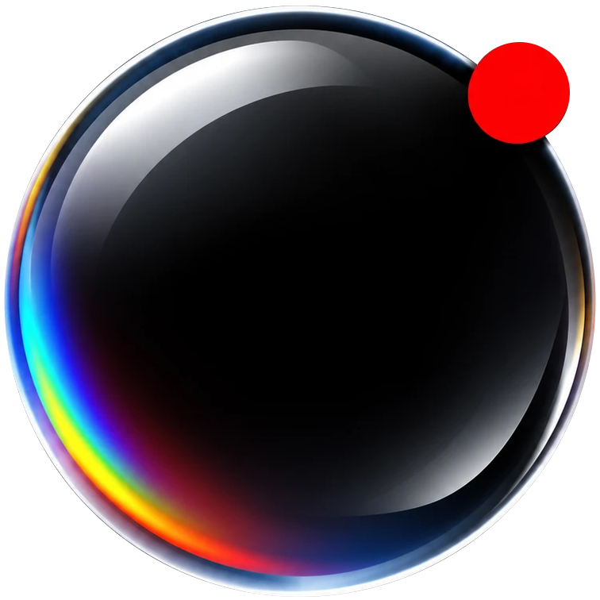
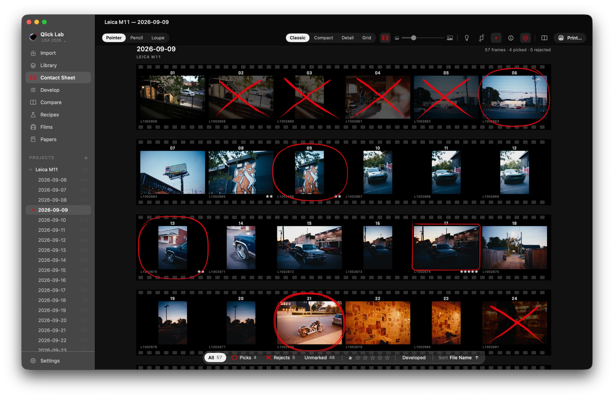
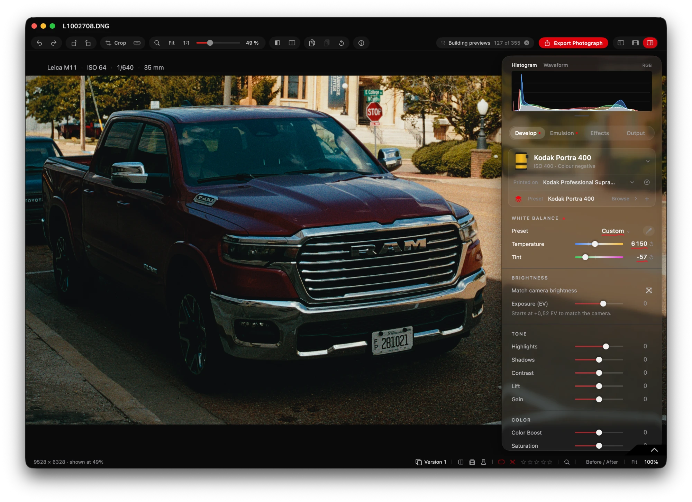
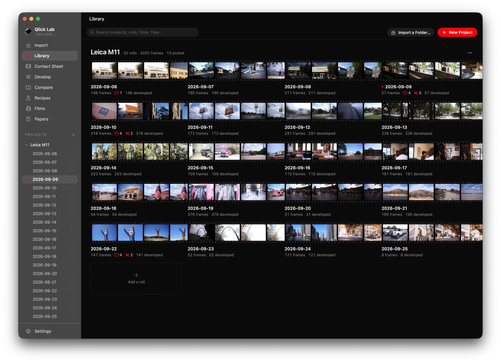

<p align="center">
  
</p>

<h1 align="center">Qlick Lab</h1>

<p align="center">
  <b>Develop your digital photographs as if they were film.</b><br>
  A free, open-source darkroom for macOS.
</p>

<p align="center">
  <a href="https://github.com/Kede0111/qlick-lab/releases/latest"><b>Download for Mac</b></a> ·
  <a href="#install">Install</a> ·
  <a href="#support-the-project">Offer a coffee ☕</a> ·
  <a href="https://github.com/Kede0111/qlick-lab/issues">Report a problem</a>
</p>

<p align="center">
  
</p>

Qlick Lab treats each digital photograph like a frame of film. It doesn't lay a filter on top. It
**develops the picture**: the light goes through a simulated film stock (its dyes, grain and halation), is printed on a
simulated paper, and comes out looking printed, not "filtered to look like it".

The film simulation is [spektrafilm](https://github.com/andreavolpato/spektrafilm), Andrea Volpato's spectral model of
film and paper, running on the GPU. Around it, Qlick Lab is built like a real lab: you load rolls, mark the contact
sheet with a red grease pencil, compare frames, develop the keepers and print.

## What it does

### The contact sheet
- Your folder becomes a **roll of 135 film**: strips with sprocket holes, frame numbers and the stock's name on the edge.
- **Mark it like a photographer does**: click to circle a frame in red pencil, ⌥-click to cross it out, drag to mark a
  series. Rate 0–5, filter by picks, rejects or unrated.
- Three layouts (film strips, tight strips, large frames with their facts), a light table, a loupe.
- **Print it**: the sheet as a vector PDF, paginated (A4, A3, Letter, 8 × 10, 24 × 30), with or without your marks.

<p align="center">
  
  
</p>

### Development
- **[62 film stocks and papers](#film-stocks-and-papers)**: Portra, Ektar, Gold, Tri-X, Velvia, CineStill and more, each with its own
  measured curves, where it comes from and how far it can be trusted. Every stock shows a preview developed on *your*
  photograph.
- Exposure, grain, halation, glare, DIR couplers, the print and the scan, crop, straighten, 35 mm borders.
- **Every slider is live**: the GPU redraws as you move it.
- **Recipes**: a look saved once, applied to a whole selection in one step. They use spektrafilm's own preset format.
- **Versions**: several interpretations of one photograph, side by side. None replaces the others.
- **Compare**: neighbouring frames, stocks, recipes, versions or before/after, with linked zoom and pan. Each view is
  a real development, not an approximation.

<p align="center">
  
</p>

### Library, import and export
- **Catalogues and projects**: a roll is a folder, wherever it is. Nothing is copied and no original is ever changed.
- **Import** from a memory card, with a journal that survives an interruption.
- RAW files from most cameras (Apple's RAW decoder and rawler), including Leica DNG, plus JPEG, TIFF and PNG.
- Export 8- or 16-bit JPEG, TIFF or PNG with an ICC profile, one at a time or in batches. The rating goes into the
  file's XMP. Film looks can also go out as a `.cube` LUT.

<p align="center">
  
  
</p>

### A Mac app
- Native AppKit and SwiftUI, with **Liquid Glass** panels on macOS 26.
- Keyboard first: P / X / U to mark, 0–5 to rate, Space for a large view, C to compare. Every key can be changed
  in Settings › Shortcuts.
- **Your photos stay on your Mac.** No account, no cloud, no tracking, no analytics. The app opens the network only
  when you click a link (GitHub, PayPal).

## Film stocks and papers

The profiles come from spektrafilm, Fotufilm and Negs, built from the manufacturers' published data (a few are
creative or experimental, and say so). The app shows where each one comes from and how far it can be trusted,
and previews it on your own photograph.

**Colour negative (22)**

Kodak Portra 160 · Portra 400 · Portra 800 · Portra 800 (Push 1) · Portra 800 (Push 2) · Ektar 100 · Gold 200 ·
Ultramax 400 · Kodacolor 100 · Aerocolor IV 2460 · Fujifilm Pro 160NS · Pro 400H · C200 · Superia 200 ·
Superia Reala 100 · X-Tra 400 · CineStill 400D · CineStill 800T · Harman Phoenix 200 · Lomography Color Negative 100 ·
LomoChrome Metropolis · LomoChrome Turquoise

**Slide (13)**

Kodak Ektachrome 100 · Kodachrome 25 · Kodachrome 64 · Kodachrome 200 · Aerochrome III 1443 (infrared) ·
Fujifilm Velvia 50 · Velvia 100 · Provia 100F · Astia 100F · Agfa Agfachrome 50 · Agfachrome 100 · Agfachrome 200 ·
Infrared Color (creative)

**Motion picture (9)**

Kodak Vision3 50D · Vision3 200T · Vision3 250D · Vision3 500T · Verita 200D · Fujifilm Eterna 500 ·
Eterna Vivid 500 · Reala 500D · F-64D

**Black and white (8)**

Kodak Tri-X 400 (experimental) · T-MAX 100 · Double-X 5222 · Tri-X Reversal 7266 · Ilford HP5 Plus · FP4 Plus ·
Delta 3200 · Fujifilm Neopan 100 Acros II

**Papers (7)**

Kodak Professional Portra Endura · Supra Endura · Ultra Endura · Endura Premier · Ektacolor Edge ·
Fujifilm Crystal Archive Type II · Ilford Multigrade RC Deluxe Grade 2 (experimental, black and white)

**Cinema print films (3)**

Kodak Vision 2383 · Vision Premier 2393 · Print Film 2302 (black and white)

## Install

1. Download `Qlick-Lab-<version>.dmg` from the [latest release](https://github.com/Kede0111/qlick-lab/releases/latest).
2. Open it and drag **Qlick Lab** into **Applications**.
3. **First launch.** Qlick Lab isn't notarized by Apple yet, so macOS stops it the first time:
   - open it once and close the warning,
   - go to **System Settings › Privacy & Security**, scroll down and click **Open Anyway** next to Qlick Lab,
   - confirm with your password. After that it opens like any other app.

   From Terminal, this does the same thing:
   ```bash
   xattr -dr com.apple.quarantine "/Applications/Qlick Lab.app"
   ```

**Requirements:** macOS 14 Sonoma or later, Apple silicon or Intel. Liquid Glass needs macOS 26. A Mac with 16 GB
of memory is comfortable for 60-megapixel RAW files.

New versions are announced on the [releases page](https://github.com/Kede0111/qlick-lab/releases). In the app,
**Qlick Lab › Check for Updates…** opens it.

## Your files

- Each photograph's marks, rating and development live in a small `.qlick` file beside it (`IMG_0412.CR3.qlick`).
  They travel with the folder, and your originals are never written to.
- A catalogue is a `.qlicklab` package: the projects and their rolls, as small JSON files. The photographs stay where
  they are.
- Both are plain, documented JSON. They belong to Qlick Lab, but nothing is locked in.

## Support the project

Qlick Lab is free, and it will stay free. It's developed in spare time by Quentin Descotte, a photographer. If it
gives you photographs you love, you can say thanks with a coffee:

<p align="center">
  <a href="https://www.paypal.com/donate/?hosted_button_id=HWP2MECER3PRA"><b>☕ Offer a coffee with PayPal</b></a>
</p>

The app asks this question itself once, after you've exported 50 photographs, and very rarely after that.
"Already Did" or "Don't ask again" stops it for good. **Qlick Lab › Support Qlick Lab…** is always in the menu.

Other ways to help: star the repository, tell other photographers about it, and
[report what doesn't work](https://github.com/Kede0111/qlick-lab/issues).

## Contact

- **Bugs and ideas**: [GitHub Issues](https://github.com/Kede0111/qlick-lab/issues) (or **Help › Report a Problem…**
  in the app).
- **Questions, photographs, conversations**: [GitHub Discussions](https://github.com/Kede0111/qlick-lab/discussions).

## Build it yourself

You need Xcode 26 or later (the macOS 26 SDK) and [Rust](https://rustup.rs) stable (1.89 or later).

```bash
scripts/build_app.sh                 # this Mac's architecture → dist/qlick-lab/Qlick Lab.app
scripts/build_app.sh --universal     # Apple silicon + Intel
scripts/build_app.sh --dev           # a test copy, Qlick Lab Dev, with its own settings and data
scripts/make_dmg.sh                  # the universal app in a DMG → dist/Qlick-Lab-<version>.dmg
open QlickLab.xcodeproj              # or work in Xcode (a build phase compiles the Rust engine)
```

The Xcode project is generated from `project.yml` by [XcodeGen](https://github.com/yonaskolb/XcodeGen): run
`xcodegen generate` after adding or removing files.

Tests:

```bash
cargo test --release                                                       # the engine
swift test --package-path macos --scratch-path target/swift-native         # the app
```

### How it's put together

The details are in [docs/architecture.md](docs/architecture.md); how to propose a change in
[CONTRIBUTING.md](CONTRIBUTING.md).

| Folder | What's in it |
|---|---|
| `macos/Sources/QlickLab` | The app: the editor, library, export (AppKit) |
| `macos/Sources/QlickLab/Lab` | The lab: contact sheet, projects, catalogues, import, compare, recipes, print (SwiftUI) |
| `crates/` | The engine in Rust: spektrafilm's model, its GPU pipeline (wgpu/Metal), RAW and colour I/O |
| `data/` | Film and paper profiles, spectral tables, borders |
| `vendor/rawler` | A patched copy of rawler, the RAW decoder |

## Licence and credits

Qlick Lab © 2026 Quentin Descotte is free software under the **GNU General Public License, version 3**
([LICENSE](LICENSE)). You may use, study, share and change it. Versions you distribute must stay under the GPL, with
their source code.

Qlick Lab stands on the work of others:

- **[spektrafilm](https://github.com/andreavolpato/spektrafilm)** © Andrea Volpato: the spectral film model and the
  film and paper profiles (CC BY-SA 4.0).
- **[spektrafilm-rs](https://github.com/turbasvin/spektrafilm-rs)** © turbasvin: the Rust port of the model.
- **[Negs](https://github.com/noahhaasis/negs)** © 2026 Noah Haasis: Qlick Lab is a modified version of Negs 0.15.0.
  The editor, the GPU engine work and the RAW pipeline come from it.
- Prep, camera brightness and waveform © 2026 yosoyelchris. Profiles adapted from Fotufilm © MUAStudio Inc.
  (CC BY-SA 4.0). Spectral upsampling table by Johannes Hanika. Lens corrections ported from darktable. rawler (LGPL-2.1),
  Sparkle (MIT), Newsreader and Rajdhani (SIL OFL).

The full inventory, with what was changed, is in [LICENSES.md](LICENSES.md).

Kodak, Fujifilm, Ilford, Agfa, Harman, Lomography, CineStill, Leica and their product names are trademarks of their
owners. Qlick Lab is not affiliated with any of them: the names only say which published film data a profile follows.

---

<details>
<summary><b>En français</b></summary>

Qlick Lab est un laboratoire argentique pour Mac, libre et gratuit. Il développe vos photos numériques comme des
négatifs : la lumière traverse un film simulé (colorants, grain, halo), elle est tirée sur un papier simulé, et le
résultat a l'air tiré, pas filtré. Vous chargez vos dossiers comme des rouleaux et marquez la planche-contact au
crayon gras rouge. Ensuite vous comparez, vous développez et vous imprimez.

Téléchargez le DMG dans les [Releases](https://github.com/Kede0111/qlick-lab/releases/latest). Au premier lancement,
autorisez l'app dans **Réglages Système › Confidentialité et sécurité › Ouvrir quand même**. Si elle vous plaît, vous
pouvez [m'offrir un café](https://www.paypal.com/donate/?hosted_button_id=HWP2MECER3PRA). Pour un bug ou une idée,
passez par les [Issues](https://github.com/Kede0111/qlick-lab/issues).

</details>
