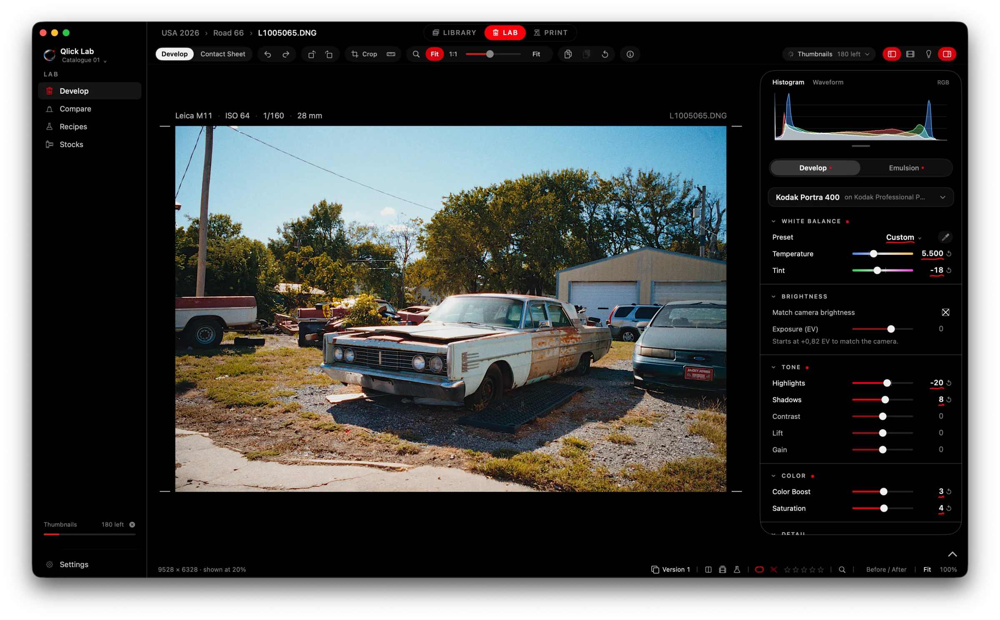
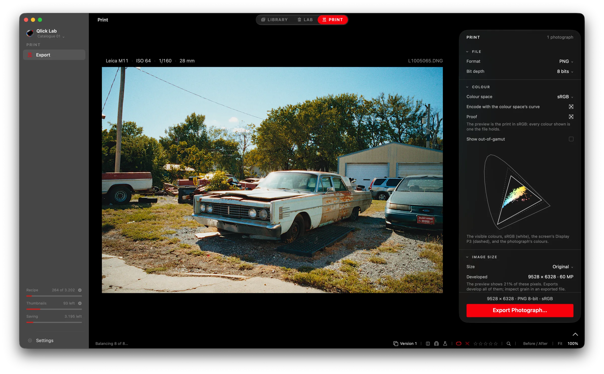
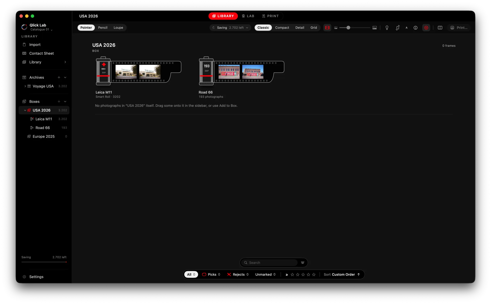
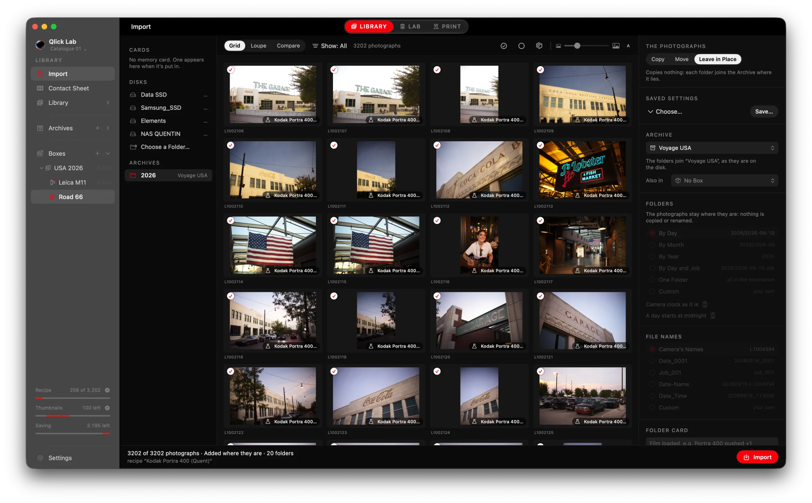
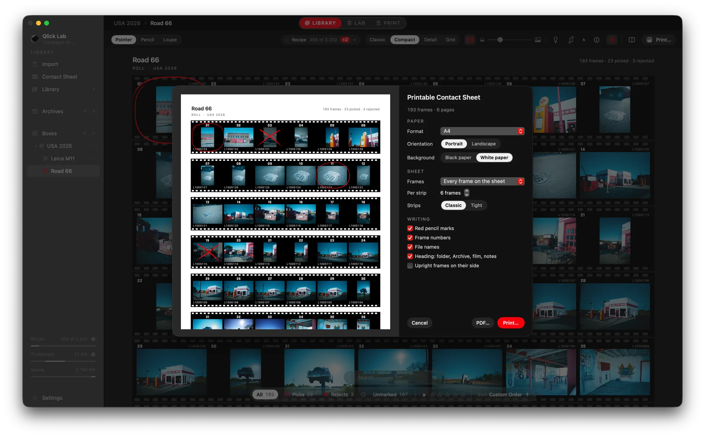
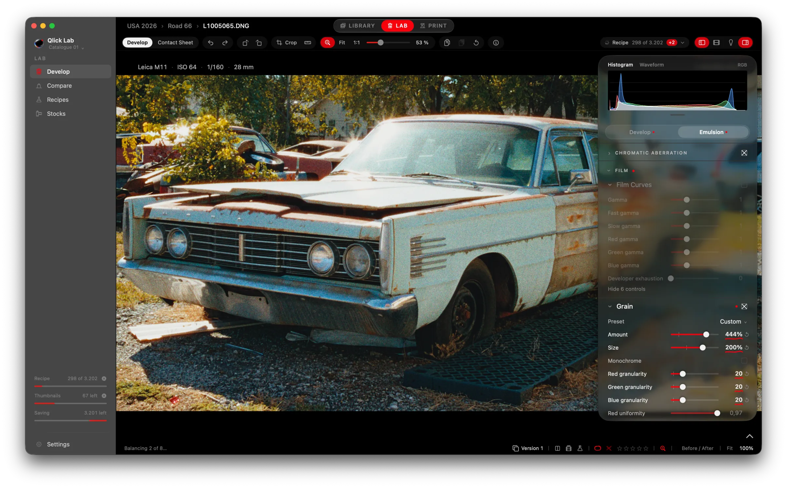

<p align="center">
  
</p>

<h1 align="center">Qlick Lab</h1>

<p align="center">
  <b>A film lab for your digital photographs.</b><br>
  Free and open source, for macOS.
</p>

<p align="center">
  <a href="https://github.com/Kede0111/qlick-lab/releases/latest"><b>Download for Mac</b></a> ·
  <a href="#install">Install</a> ·
  <a href="#support-the-project">Offer a coffee ☕</a> ·
  <a href="https://github.com/Kede0111/qlick-lab/issues">Report a problem</a>
</p>

<p align="center">
  
</p>

Qlick Lab develops your digital photographs the way a film lab develops negatives. It doesn't lay a filter over
the picture: the light of each RAW file goes through a simulated film stock (its dyes, its grain, its halation), is
printed on a simulated paper, and comes out looking like a print. The simulation is spectral, built from the
manufacturers' published data, and runs on the Mac's GPU.

Around that engine, the app is organised like a real lab, from the roll that comes in to the print that goes out:
you load your rolls, mark the contact sheet with a red grease pencil, develop the keepers and print.

**What it is not:** a general photo editor. There are no layers, no masks and no retouching brushes. Qlick Lab does
one thing, turning digital RAW files into film, and keeps the gestures of a physical lab while doing it.

## Three parts: Library, Lab, Print

Everything in the app belongs to one of three parts, chosen with the switch at the top of the window
(**⌘1**, **⌘2**, **⌘3**). The sidebar shows only what the part needs, and each part comes back to where you left it.

| Part | What happens there |
|---|---|
| **Library** | Import, the contact sheet, the Archives and the Boxes: bringing photographs in, sorting and marking them. |
| **Lab** | Develop, Compare, Recipes and Stocks: choosing a film and a paper, and developing. |
| **Print** | Export: the photograph as it will be printed, its colour space, its size, and the file. |

From Develop, **G** (or the toggle at the top of the toolbar) switches to the contact sheet of what you're working
on, and back.

<p align="center">
  
  
  
</p>

## The Library: catalogues, Archives, Boxes and Rolls

Your photographs stay where they are on your disks. The Library is a way of looking at them and sorting them, and
**the app never moves, renames or deletes a photograph** on its own. The two exceptions are both explicit: an import
that you ask to copy or move, and "Delete from Disk", which asks twice.

- **A catalogue** (`.qlicklab`) holds one body of work: its Archives, its Boxes, its Rolls and its settings. One
  catalogue is open at a time. **File › New Catalog**, **Open Catalog** and **Close Catalog** (⌥⇧⌘W) switch between
  them, and closing one leaves the lab empty without quitting.
- **Archives** are where the photographs live. An Archive is one subject you imported ("Voyage USA", "Leica M11"), and
  it shows its folders exactly as they are on the disk, at every depth, kept up to date as the disk changes. It's a
  read-only view: you never sort inside an Archive, you look at it. A disk that is unplugged or a network share that
  stops answering is set aside without freezing the lab, and **Locate Folder…** points a folder that moved to its new place.
- **Boxes** are where you sort. A Box gathers photographs from any Archive, and Boxes nest to any depth
  ("USA 2026" › "Road 66"). Nothing is copied: a photograph can sit in as many Boxes as you like.
- **Rolls** live inside Boxes and hold a sequence of frames, in your own order. A Roll can carry a film stock or a
  recipe for all its frames. A **Smart Roll** fills itself from rules (rating, film, camera, lens, ISO, dates,
  keywords…).

Everything is sorted by drag and drop. Photographs dragged from one Box to another move, and **⌥** copies them. A
folder of an Archive dropped on a Box becomes a Roll. Each gesture says what it will do while you drag and is undone
with one ⌘Z.

<p align="center">
  
</p>

### Import

- From a memory card, a disk or a network share. Choose to **Copy**, **Move** or **Leave in Place**: in place, the
  folders simply join an Archive as they are.
- Every import goes into an Archive (an existing one or a new one), and can also go into a Box or a Roll.
- Folders by day, month, year or your own pattern, file names from the camera or your own pattern, with an example
  line before anything is written. Duplicates and unreadable files are flagged.
- A recipe can be applied as the photographs come in. They are there at once, and their previews are made in the
  background.
- A journal keeps the import safe if it's interrupted.

<p align="center">
  
  
</p>

### The contact sheet

- Each folder, Box or Roll becomes **135 film**: strips with sprocket holes, frame numbers and file names on the edge.
- **Mark it as a photographer does**: click to circle a frame in red pencil, ⌥-click to cross it out, drag across a
  series. P / X / U to pick, reject or unmark, 0–5 to rate, ⇧ with a key to mark and move on.
- Search by field (`rating:>=3 film:portra camera:m11 iso:>800 date:2026-09`), filters by period, film, camera and lens,
  keywords, titles and captions, stacks of bursts.
- Four layouts (Classic, Compact, Detail, Grid), a light table and a loupe.
- **Print the sheet**: a vector PDF on A4, A3, Letter, 8 × 10 or 24 × 30, black or white paper, with your pencil marks.
- **Remove…** takes photographs out of a Box or out of the catalogue. Files are deleted from the disk only if you say
  so, twice.

<p align="center">
  
</p>

## The Lab: developing

- **[62 film stocks and papers](#film-stocks-and-papers)**: Portra, Ektar, Gold, Tri-X, Velvia, CineStill and more,
  each with its measured curves, where it comes from and how far it can be trusted. Every stock shows a preview
  developed on *your* photograph.
- **The film card** at the top of the panel: the film, the paper it's printed on, the recipe.
- **Develop**: white balance, brightness matched to the camera, tone, colour, detail, crop and Auto Straighten.
- **Emulsion**: the film's curves and couplers, grain, halation from the highlights, diffusion, chromatic aberration.
  Grain and halation have their own presets.
- **Every slider is live**: the GPU redraws as you move it, and the next frames are developed ahead as you step through
  a roll.
- **Recipes**: a look saved once, applied to a whole selection, a Roll or an import in one step. Share them as a
  `.qlickrecipes` bundle.
- **Versions** of one photograph side by side, and **Compare** across frames, stocks, recipes or before/after, with
  linked zoom.

<p align="center">
  
</p>

## Print

Print shows the photograph as it will be printed. You choose the file (JPEG, TIFF or PNG, 8 or 16 bits), the colour
space (sRGB, Display P3, Adobe RGB, ProPhoto RGB) with a soft proof and a gamut chart, the size and the border.
The rating goes into the file's XMP. A film look can also go out as a `.cube` LUT.

## Liquid Glass or solid black

On macOS 26 the panels, the sidebar and the part switch are made of **Liquid Glass**, so the photograph shows
through. If you'd rather see nothing but the picture, **Settings › Interface › Solid surfaces** puts them on the
lab's black with a hairline edge.

<p align="center">
  
  
</p>
<p align="center"><sub>Left: Liquid Glass. Right: solid surfaces.</sub></p>

## A Mac app

- Native AppKit and SwiftUI over a Rust engine, on the GPU through Metal.
- Keyboard first, and every key can be changed in **Settings › Shortcuts**.
- Long work (thumbnails, previews, recipes on thousands of frames) runs in the background, with its progress in the
  sidebar and a Stop button.
- **Your photos stay on your Mac.** No account, no cloud, no tracking, no analytics. The app opens the network only
  when you click a link (GitHub, PayPal) and to look for a new version (which you can turn off).

## Film stocks and papers

The profiles come from spektrafilm, Fotufilm and Negs, built from the manufacturers' published data (a few are
creative or experimental, and say so). The app shows where each one comes from and how far it can be trusted,
and previews it on your own photograph.

**Colour negative (22)**

Kodak Portra 160 · Portra 400 · Portra 800 · Portra 800 (Push 1) · Portra 800 (Push 2) · Ektar 100 · Gold 200 ·
Ultramax 400 · Kodacolor 100 · Aerocolor IV 2460 · Fujifilm Pro 160NS · Pro 400H · C200 · Superia 200 ·
Superia Reala 100 · X-Tra 400 · CineStill 400D · CineStill 800T · Harman Phoenix 200 · Lomography Color Negative 100 ·
LomoChrome Metropolis · LomoChrome Turquoise

**Slide (13)**

Kodak Ektachrome 100 · Kodachrome 25 · Kodachrome 64 · Kodachrome 200 · Aerochrome III 1443 (infrared) ·
Fujifilm Velvia 50 · Velvia 100 · Provia 100F · Astia 100F · Agfa Agfachrome 50 · Agfachrome 100 · Agfachrome 200 ·
Infrared Color (creative)

**Motion picture (9)**

Kodak Vision3 50D · Vision3 200T · Vision3 250D · Vision3 500T · Verita 200D · Fujifilm Eterna 500 ·
Eterna Vivid 500 · Reala 500D · F-64D

**Black and white (8)**

Kodak Tri-X 400 (experimental) · T-MAX 100 · Double-X 5222 · Tri-X Reversal 7266 · Ilford HP5 Plus · FP4 Plus ·
Delta 3200 · Fujifilm Neopan 100 Acros II

**Papers (7)**

Kodak Professional Portra Endura · Supra Endura · Ultra Endura · Endura Premier · Ektacolor Edge ·
Fujifilm Crystal Archive Type II · Ilford Multigrade RC Deluxe Grade 2 (experimental, black and white)

**Cinema print films (3)**

Kodak Vision 2383 · Vision Premier 2393 · Print Film 2302 (black and white)

## Install

1. Download `Qlick-Lab-<version>.dmg` from the [latest release](https://github.com/Kede0111/qlick-lab/releases/latest).
2. Open it and drag **Qlick Lab** into **Applications**.
3. **First launch.** Qlick Lab isn't notarized by Apple yet, so macOS stops it the first time:
   - open it once and close the warning,
   - go to **System Settings › Privacy & Security**, scroll down and click **Open Anyway** next to Qlick Lab,
   - confirm with your password. After that it opens like any other app.

   From Terminal, this does the same thing:
   ```bash
   xattr -dr com.apple.quarantine "/Applications/Qlick Lab.app"
   ```

**Requirements:** macOS 14 Sonoma or later, Apple silicon or Intel. Liquid Glass needs macOS 26. A Mac with 16 GB
of memory is comfortable for 60-megapixel RAW files.

**Updates.** From 0.2.0 on, Qlick Lab checks for a new version by itself and offers to install it (signed by the
lab, checked before it's installed). **Qlick Lab › Check for Updates…** asks at once, and **Settings › About** turns
the automatic check off. Coming from 0.1.x, install 0.2.0 once by hand; the next ones come by themselves.

## Your files

- Each photograph's marks, rating and development live in a small `.qlick` file beside it (`IMG_0412.CR3.qlick`).
  They travel with the folder, and your originals are never written to.
- Each folder of an Archive can carry a `Roll.qlickroll` card (film, camera, notes), so it keeps them if you move it.
- A catalogue is a `.qlicklab` package: the Archives, Boxes, Rolls and their order, as small JSON files. The
  photographs stay where they are.
- All of them are plain, documented JSON. They belong to Qlick Lab, but nothing is locked in.

## Support the project

Qlick Lab is free, and it will stay free. It's developed in spare time by Quentin Descotte, a photographer. If it
gives you photographs you love, you can say thanks with a coffee:

<p align="center">
  <a href="https://www.paypal.com/donate/?hosted_button_id=HWP2MECER3PRA"><b>☕ Offer a coffee with PayPal</b></a>
</p>

The app asks this question itself once, after you've exported 50 photographs, and very rarely after that.
"Already Did" or "Don't ask again" stops it for good. **Qlick Lab › Support Qlick Lab…** is always in the menu.

Other ways to help: star the repository, tell other photographers about it, and
[report what doesn't work](https://github.com/Kede0111/qlick-lab/issues).

## Contact

- **Bugs and ideas**: [GitHub Issues](https://github.com/Kede0111/qlick-lab/issues) (or **Help › Report a Problem…**
  in the app).
- **Questions, photographs, conversations**: [GitHub Discussions](https://github.com/Kede0111/qlick-lab/discussions).

## Build it yourself

You need Xcode 26 or later (the macOS 26 SDK) and [Rust](https://rustup.rs) stable (1.89 or later).

```bash
scripts/build_app.sh                 # this Mac's architecture → dist/qlick-lab/Qlick Lab.app
scripts/build_app.sh --universal     # Apple silicon + Intel
scripts/build_app.sh --dev           # a test copy, Qlick Lab Dev, with its own settings and data
scripts/make_dmg.sh                  # the universal app in a DMG → dist/Qlick-Lab-<version>.dmg
open QlickLab.xcodeproj              # or work in Xcode (a build phase compiles the Rust engine)
```

The Xcode project is generated from `project.yml` by [XcodeGen](https://github.com/yonaskolb/XcodeGen): run
`xcodegen generate` after adding or removing files.

Tests:

```bash
cargo test --release                                                       # the engine
swift test --package-path macos --scratch-path target/swift-native         # the app
```

### How it's put together

The details are in [docs/architecture.md](docs/architecture.md); how to propose a change in
[CONTRIBUTING.md](CONTRIBUTING.md).

| Folder | What's in it |
|---|---|
| `macos/Sources/QlickLab` | The app, one folder per role: `App`, `Library`, `Import`, `ContactSheet`, `Develop`, `Compare`, `Recipes`, `Print`, `Export`, `Engine`, `Files`, `Design` |
| `crates/` | The engine in Rust: spektrafilm's model, its GPU pipeline (wgpu/Metal), RAW and colour I/O |
| `data/` | Film and paper profiles, spectral tables, borders |
| `vendor/rawler` | A patched copy of rawler, the RAW decoder |

## Licence and credits

Qlick Lab © 2026 Quentin Descotte is free software under the **GNU General Public License, version 3**
([LICENSE](LICENSE)). You may use, study, share and change it. Versions you distribute must stay under the GPL, with
their source code.

Qlick Lab stands on the work of others:

- **[spektrafilm](https://github.com/andreavolpato/spektrafilm)** © Andrea Volpato: the spectral film model and the
  film and paper profiles (CC BY-SA 4.0).
- **[spektrafilm-rs](https://github.com/turbasvin/spektrafilm-rs)** © turbasvin: the Rust port of the model.
- **[Negs](https://github.com/noahhaasis/negs)** © 2026 Noah Haasis: Qlick Lab is a modified version of Negs 0.15.0.
  The editor, the GPU engine work and the RAW pipeline come from it.
- Prep, camera brightness and waveform © 2026 yosoyelchris. Profiles adapted from Fotufilm © MUAStudio Inc.
  (CC BY-SA 4.0). Spectral upsampling table by Johannes Hanika. Lens corrections ported from darktable. rawler (LGPL-2.1),
  Sparkle (MIT), Newsreader and Rajdhani (SIL OFL).

The full inventory, with what was changed, is in [LICENSES.md](LICENSES.md).

Kodak, Fujifilm, Ilford, Agfa, Harman, Lomography, CineStill, Leica and their product names are trademarks of their
owners. Qlick Lab is not affiliated with any of them: the names only say which published film data a profile follows.

---

<details>
<summary><b>En français</b></summary>

Qlick Lab est un laboratoire argentique pour Mac, libre et gratuit. Il développe vos photos numériques comme un
labo développe des négatifs : la lumière de chaque fichier RAW traverse un film simulé (colorants, grain, halo), elle
est tirée sur un papier simulé, et le résultat a l'air d'un tirage, pas d'un filtre. La simulation est spectrale,
construite à partir des données publiées par les fabricants.

L'application est organisée en trois parties, comme un vrai labo :

- **Library** : l'import, la planche-contact, les Archives (vos dossiers tels qu'ils sont sur le disque, jamais
  déplacés) et les Boxes (où vous triez, avec des Rolls et des Smart Rolls). Un catalogue ouvert à la fois.
- **Lab** : le développement, la comparaison, les recettes et les films.
- **Print** : l'export, avec l'espace colorimétrique, l'épreuvage et la taille.

Vous marquez la planche-contact au crayon gras rouge, vous développez les meilleures images et vous les tirez. Les
panneaux sont en Liquid Glass sur macOS 26, ou en noir plein avec **Réglages › Interface › Solid surfaces**.

Téléchargez le DMG dans les [Releases](https://github.com/Kede0111/qlick-lab/releases/latest). Au premier lancement,
autorisez l'app dans **Réglages Système › Confidentialité et sécurité › Ouvrir quand même**. Si elle vous plaît, vous
pouvez [m'offrir un café](https://www.paypal.com/donate/?hosted_button_id=HWP2MECER3PRA). Pour un bug ou une idée,
passez par les [Issues](https://github.com/Kede0111/qlick-lab/issues).

</details>
