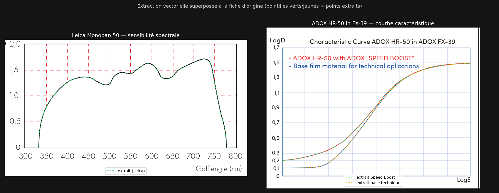
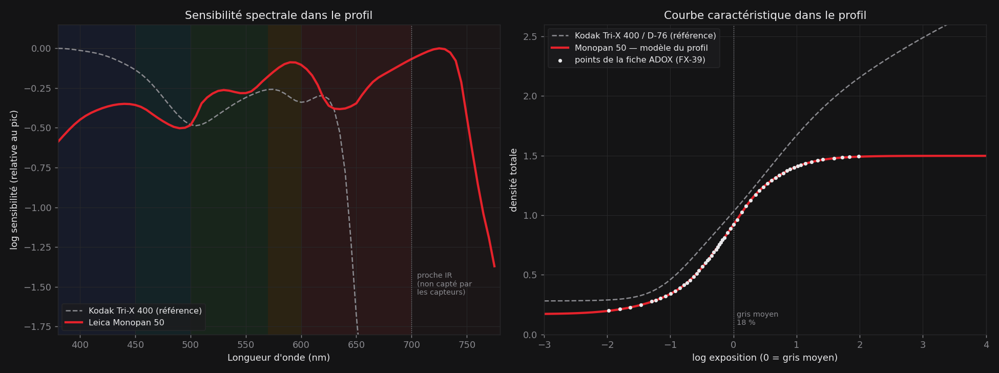

# Leica Monopan 50 source record — 22 November 2026

A new source-based preparation in spektrafilm's profile format, `data/profiles/leica_monopan_50.json`, built the same
way as the Tri-X 400 record ([../bw-expansion/README.md](../bw-expansion/README.md)). Hashes, axis calibrations and
path counts are in [extraction.json](extraction.json); the fit and calibration results in
[preparation-report.json](preparation-report.json).

| Source | Extraction | Range used |
|---|---|---|
| [Leica Monopan 50, Technische gegevens, juni 2025](https://leica-camera.com/sites/default/files/pm-23344-Leica-Monopan50_Technical-Data_nl.pdf), p2, spectral sensitivity | One vector path, 25 cubic Béziers; 1 201 samples in `monopan50-sensitivity.csv`, with PDF coordinates | 331–779 nm, log sensitivity 0–1.72 |
| [ADOX HR-50, Technische Beschreibung, 20 Nov 2018](https://www.macodirect.de/media/pdf/c2/97/cf/ASC5011_Datenblatt_e.pdf), p1, characteristic curve in FX-39, red curve "with ADOX SPEED BOOST" | One vector path, 14 Béziers; 673 samples in `hr50-fx39-speedboost.csv`. The blue "base film material for technical applications" curve is kept beside it for reference, unused | density 0.20–1.49 over 3.96 log E |



**Why ADOX's curve.** Leica publishes no characteristic curve. Its development table (ATOMAL, FX-39, HR-DEV, DDX,
XTOL: same dilutions, times and gamma 0.65), its reciprocity table, ISO 50, 280 lp/mm and the 780 nm sensitisation
are those of ADOX HR-50. That Monopan 50 *is* HR-50 is an assumption; neither company states it.

**Axes.** The Leica x axis is fitted to the centres of its eleven wavelength labels, the y axis to its three dashed
grid lines. The ADOX density axis is fitted to its nine labelled grid lines and frame; its log-exposure axis has no
numbers. Its grid is regular (17.24 pt per column). Scaling it so the straight part (net D 0.55–1.15) has the sheet's
gamma 0.65 gives 0.487 log E per column, so the grid is read as the usual 0.5 per column; the implied gamma is 0.633.

**Preparation** (`scripts/monopan/prepare.py`):
- Sensitivity: PCHIP onto the engine's 380–780 nm grid; `null` where the curve is on the graph floor (780 nm).
  Scaled so an 18.4 % grey under D55 gives unit raw exposure: transferred from Tri-X with a flat-grey approximation,
  then corrected by the factor measured in the engine (the reconstructed grey is not flat in the deep red, where this
  film is most sensitive). `crates/spektrafilm-core/tests/leica_monopan.rs` checks the grey in the engine.
- Characteristic curve: four positive normal-CDF components plus a free base + fog (0.10–0.20 D: the floor of
  ADOX's base film, same PET support, and the lowest plotted density). Fitted base + fog: 0.172 D. Largest source
  error 0.0048 D (gate 0.01 D). Shifted so engine log E 0 gives net density 0.75, as Tri-X.
- The toe below D 0.20 and the shoulder above D 1.49 are smooth continuations, not measurements. The shoulder is
  the sheet's: HR-50 in FX-39 levels off near 1.5 D.



**Not modelled, or assumed.** Grain: no published RMS granularity; `presets/grain.toml` uses 5 (finer than Acros II's 7),
to adjust against real scans. Development: one condition only (FX-39 1+9, 7 min 15 s, 20 °C); the other developers of
the table are not separate curves. Near infrared: the profile carries the sensitivity to 775 nm, but a camera's IR-cut
filter and the RGB-to-spectrum reconstruction leave little energy beyond 700 nm, so infrared effects (white foliage
under a deep red filter) are understated. Printed on `ilford_mgrc_deluxe_grade2`, as Tri-X.

Reproduce from the repository root (Python ≥ 3.9 with `scripts/monopan/requirements.txt`):

```sh
python scripts/monopan/extract_sources.py --leica-pdf LEICA.pdf --adox-pdf ADOX.pdf   # optional: re-read the PDFs
python scripts/monopan/prepare.py --output-dir data/profiles
cargo test --release -p spektrafilm-core --test leica_monopan
```

Manufacturer graphs retain Leica Camera AG's and ADOX Fotowerke GmbH's rights. No endorsement is claimed.
